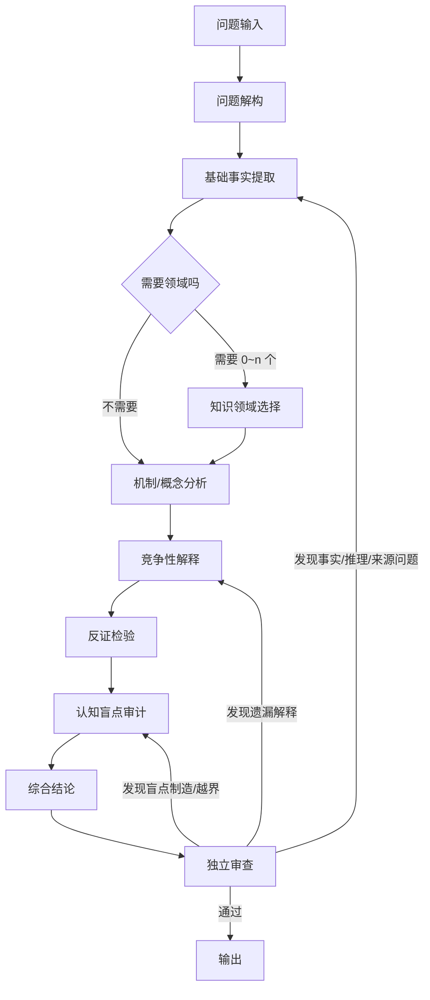

# 万物可答 v3：审查与架构重构报告

- **审查基线**：公开仓库 `jiangyuchen144-cmd/wanwu-keda`，提交 `abb8bfb`（v2，2026-11-12 21:29 +0800）。
- **重构目标**：修复分析架构，而不是继续增加学科、理论或案例。
- **测试**：九个问题的实际生成结果、独立审查记录与失败案例，见 `tests/`。
- **范围说明**：这是一个**提示词技能**，没有运行时引擎。下文所说的「机制」都是模型执行规范；测试是真实模型生成，但不是确定性程序保证。

---

## 0. 先说明：反馈与 v2 HEAD 不完全一致

逐文件核对后，用户列出的 10 个问题中，有 4 项在 v2 HEAD 里已经不是原文描述的状态。为了避免「照着一个不存在的旧版本改」并伪造 diff，先列出实际情况：

| # | 反馈描述 | v2 HEAD 实际 | 等价问题 | v3 处理 |
| --- | --- | --- | --- | --- |
| 1 | 所有问题必须经过固定输出骨架 | 有「直答/标准/深度」三档，但标准/深度仍绑定模块数与字数 | 模块配额就是软性骨架 | 删除配额，改为动态可选块 |
| 2 | 默认遍历 31 个学科 | 没有「默认遍历」；矩阵是 44 格（31 学科+13 方法），引擎说按需选择 | 输出模块仍要求「3～6 个学科」，等于强制多选 | 改为 0～n；每个领域必须说明提供什么；允许矩阵外 |
| 3 | 默认深挖 10 个学科 | 没有「默认深挖 10 个学科」 | 深度档要求 8～10 个模块 | 删除模块数，深度由风险/争议触发 |
| 4 | 固定 8～12 条盲点 | 实际是 2～5 条 | 仍是固定数量范围 | 四态审计，0 条合法 |
| 5 | 固定 3500～4500 字 | 实际是标准 800～1800 字、深度 2500～5000 字 | 仍用字数暗示深度 | 删除字数配额，长度由内容决定 |
| 6 | 全流程默认不联网 | 没有「默认不联网」；有「何时必须联网」 | 缺少结构化来源记录、检索决策和不可核验时的降级 | 新增来源表、检索协议、未核验封顶 |
| 7 | 仍用证明/论证/推测三标签 | v2 已改为三维：信息性质/证据状态/推理类型 | A 维度的分类与用户要求不完全一致，且组合规则有漏洞 | 改为六类信息性质，明确价值判断不标证据等级 |
| 8 | 缺少独立认知盲点审计 | 有「引擎四」，但没有独立阶段，且以七类扫描为主 | 盲点仍可能变成分类填表 | 新增独立阶段、四态、五字段、零条合法 |
| 9 | 缺少结论到基础事实的追溯 | 只有原则性「追溯依赖」段落 | 没有 ID、来源映射、断裂降级、输出格式 | 新增 `traceability.md` 与结论卡/来源表 |
| 10 | 缺少独立回答质量审查 | 没有独立审查流程 | 生成与自检混在一起 | 新增 `review.md` 十项审查与修正协议 |

**结论**：反馈的方向成立，但具体条文需要按 HEAD 修正。v3 的 diff 针对的是实际存在的配额、缺流程、缺追溯，而不是复述不存在的规则。

---

## 1. 新架构

### 1.1 主流程



文字版：

```
问题输入
  → 问题解构
  → 基础事实提取
  → 知识领域选择（0～n，可矩阵外）
  → 机制分析
  → 竞争性解释
  → 反证检验
  → 认知盲点审计
  → 综合结论
  → 独立审查
      ├─ 事实/来源错 → 回事实层
      ├─ 推理/因果错 → 回机制/反证
      ├─ 遗漏解释 → 回竞争解释
      └─ 通过 → 输出
```

### 1.2 模式门

```
问题
 ├─ 简单、稳定、低风险 → 快速：答案 + 依据 + 条件
 ├─ 需解释/比较/个人决策 → 标准：关键事实 + 机制 + 真实盲点 + 边界
 └─ 高风险/强争议/多领域/价值冲突/时效 → 深度：全流程 + 追溯 + 审查
```

模式不是身份；可升级、可降级。**没有「必须写满十段」的路径。**

### 1.3 追溯链

```
C1 结论
├─ R1 推理
│  ├─ A1 假设
│  ├─ F1 事实 ← S1 来源
│  └─ F2 事实 ← S2 来源
└─ 反证条件 / 放弃条件
```

追溯状态：`完整`／`部分`／`断裂`。部分或断裂 → 结论降级；不能补故事。

### 1.4 盲点审计

```
候选盲点
 ├─ 用户原话直接支持？ → 已识别
 ├─ 对话有相关证据但需确认？ → 有依据的推断
 ├─ AI 怀疑但证据不足？ → 待验证假设
 └─ 没有理由？ → 不适用（0 条也合法）
```

每条五字段：隐含前提、缺失事实、错误位置、对结论影响、检验方式。禁止心理诊断。

---

## 2. 新旧架构对比

| 维度 | v2 `abb8bfb` | v3 |
| --- | --- | --- |
| 主流程 | 四引擎，按需调用，无显式顺序 | 十阶段，显式顺序与回退 |
| 模式 | 三档，但绑定模块数/字数 | 三档，无模块/字数配额 |
| 学科 | 动态选择，但输出要求 3～6 个 | 0～n；每个必须提供不同工具/变量；矩阵外允许 |
| 输出 | 标准 4～6 模块/800～1800 字；深度 8～10 模块/2500～5000 字 | 可选块；无固定数；长度由内容决定 |
| 盲点 | 七类；2～5 条 | 四态；0 条合法；五字段；反诊断 |
| 追溯 | 原则性「追溯依赖」 | 结论卡、ID、来源表、状态、降级 |
| 来源 | 分级 + 联网规则 | 结构化来源卡 + 检索决策 + 未核验封顶 |
| 审查 | 无独立流程 | 十项独立审查 + 修正协议 |
| 证据标签 | 三维，但 A 维是事实/定义/推断/理论/价值 | A 维六类：事实/定义/经验关系/因果推断/理论解释/价值判断 |
| 学科矩阵 | 44 格；部分理论/案例未核验 | 31+13；24 张理论卡；标注 `[争议]`/`[线索]` |
| 简单问题 | 直答档，但仍可能被模块化 | 快速模式明确禁止学科清单/追溯附录/硬造盲点 |

### 2.1 实际删除/替换的硬规则

| v2 原文 | v3 |
| --- | --- |
| `标准：4～6 个模块` | 无模块数；按需选块 |
| `深度：8～10 个模块` | 无模块数；完整流程即可 |
| `标准：800～1800 字；深度：2500～5000 字` | 无字数配额 |
| `最相关学科与分析方法：3～6 个` | `0～n`；每个必须说明工具/变量 |
| `盲点：2～5 条` | 无条数；0 条合法 |
| `证明／论证／推测` | 三维标签；价值判断不标证据等级 |

---

## 3. 核心机制与文件映射

| 机制 | 实现文件 | 具体内容 | 是否经过实际测试 |
| --- | --- | --- | --- |
| 模式选择 | `SKILL.md`、`workflow.md`、`output.md` | 快速/标准/深度判据；可升级/降级；无长度配额 | 九题均实际选择模式；见测试表 |
| 十阶段流程 | `SKILL.md`、`workflow.md` | 输入→解构→事实→领域→机制→竞争解释→反证→盲点→结论→审查 | 九题实际执行；复杂题有完整流程 |
| 问题解构 | `workflow.md` §2 | 问题类型、隐含前提、问题契约、混合问题拆分 | q2/q5/q6/q7/q9 可见 |
| 基础事实提取 | `workflow.md` §3 | 承重事实、事实卡、事实缺口 | q3/q4/q5 可见 |
| 领域选择 | `facets.md`、`workflow.md` §4 | 0～n、选择记录、矩阵外、禁止遍历 | q1 未选领域；q3/q4 选少量领域 |
| 机制分析 | `explanation.md` §1 | 机制链、必要/充分/贡献、量级/时间 | q3/q4/q7 可见 |
| 竞争解释 | `explanation.md` §2 | 解释卡、区分性观察、证据差距 | q3/q4/q5/q9 可见 |
| 反证/可证伪 | `explanation.md` §3-5 | 反事实、放弃条件、不可区分 | q4/q5/q9 可见 |
| 四态盲点 | `blindspots.md` | 已识别/有依据推断/待验证/不适用；五字段；反诊断 | q5/q6/q7 重点测试 |
| 三维证据 | `evidence.md` | A 六类、B 五级、C 五类；价值判断不标证据 | 九题均有标注/区分 |
| 追溯系统 | `traceability.md` | 结论卡、ID、来源表、状态、降级 | q3/q4/q5/q8/q9 有追溯 |
| 来源管理 | `evidence.md` §6-7 | 来源字段、优先级、检索决策、未核验封顶 | q4/q5 有来源；未联网处标注 |
| 动态输出 | `output.md` | 可选块、快速/标准/深度形态、禁止清单 | 九题输出长度/结构不同 |
| 独立审查 | `review.md` | 十项检查、等级、修正协议 | 九个独立 review agent 实际审查 |
| 理论准确性 | `facets.md`、`theory-cards.md` | 24 张卡；争议/线索标记；纠正 25+ 处 | 静态审查；未逐篇核对原文 |

---

## 4. 九个问题的实际测试

### 4.1 测试方法

- 日期：2026-11-12。
- 环境：DeepSeek Harness 的独立 subagent（deepseek-flash）；每个问题一个生成 agent，另起一个未参与生成的审查 agent。
- 原始稿：`tests/drafts/qN.md`；审查后答案：`tests/outputs/qN.md`；审查记录：`tests/reviews/qN.md`。
- 审查依据：`references/review.md` 十项检查；重点题另加来源核对（q4 的 FRED 序列、q7 的元分析口径、q5 的 Acemoglu 摘要）。
- 额外人工抽查：`tests/manual-source-check.md`。
- 技能文件哈希：测试时版本在 `tests/skill-hash-at-generation.txt`；最终版本在 `tests/skill-hash.txt`。测试后只做了文档一致性澄清，见 `tests/post-test-doc-fixes.md`。
- 局限：测试不是自动化回归；同模型审查仍可能漏错；九题不覆盖医疗、法律、金融等高风险场景。

见 `tests/test-report.md` 与 `tests/outputs/`。下表是摘要（详细逐字记录不在此重复）：

| # | 问题 | 实际模式 | 关键通过项 | 失败/风险 |
| --- | --- | --- | --- | --- |
| 1 | 1+1 为什么等于 2 | 快速 | 公理/定义/演绎区分正确；未展开学科、盲点、追溯 | 初稿参数代入错误、二进制被当成另一套算术；审查已改 |
| 2 | 我是谁 | 标准 | 区分登记身份、人格同一性、关系身份、价值选择；不假装知道用户资料 | 初稿把判据选择整体当价值选择；审查改为「判据受反例检验，用途/代价才是价值」 |
| 3 | 人为什么会贫穷 | 标准 | 三层（个人/群体/国家）、三种贫困口径、结构/文化/个人解释；来源较扎实 | 初稿改判方向写反、把行为变化当判决性检验；审查已改 |
| 4 | AI 会不会取代人类工作 | 标准（可争议，见失败案例） | 任务/岗位/职业分层；描述性证据与因果估计分开；条件性判断 | 初稿把 25-54 岁就业人口比写成 71.9%，且链接到 20-24 岁劳动参与率序列；审查已改为 80.7% / LNS12300060 |
| 5 | 民主是否优于其他制度 | 深度 | 拆评价指标、混合政体、国家能力；增长证据冲突；价值选择归还用户；审查补 C1–C3 追溯表 | 初稿把增长争议也归为价值；已改「价值权重」；Sen/魏玛表述已校准 |
| 6 | 财富还是自由 | 标准 | 识别价值冲突；拆自由层次；收入-幸福研究标为相关而非因果；区分生活评价与日常情绪 | 初稿把「主观体验」合并、7.5 万缺家庭口径；审查已改 |
| 7 | 知道该学习却打游戏 | 标准 | 不诊断；多种待验证机制；把「应该」作为价值前提；改环境/降低启动 | 初稿把「94 个独立检验」写成「94 项研究」，把情绪机制写成用户事实；审查已改 |
| 8 | 如何判断信念为真 | 标准 | 区分真与确证；数学/经验/价值/证言分域；承认不知道 | 初稿缺数学逻辑分域、证言依赖、不知道终点；审查已补 |
| 9 | 所有人都信错误事实会变真吗 | 标准 | 共识不是真理制造者；制度性事实与自证预言的边界；不滑向相对主义 | 初稿把制度构成写成「原本为假后来成真」、经验证据笼统；审查已拆 |

---

## 5. 发现的失败案例

以下都是实际生成或审查中发现的问题，不是假设。

### 5.1 q1：推导参数写错，二进制被当成另一套算术

初稿写「在 a+S(b)=S(a+b) 中取 a=1、b=1」得到 1+1=S(1)，与所写链不符；正确应为先把 1 写成 S(0)，再取 a=1、b=0。初稿还把二进制与模 2 并列，读者会以为「二进制里 1+1 不等于 2」。独立审查修正；答案结论未变，快速模式保持。

### 5.2 q7：把「94 个独立检验」写成「94 项研究」，并把一种机制写成用户事实

初稿的 Gollwitzer & Sheeran 2006 元分析写「94 项研究」，原文口径是 94 个独立检验；这会把证据数量说得更大。初稿还把「你先用游戏把不舒服压下去」写成对用户动机的断言，接近心理归因。审查改为条件句，并把「能说明」改成「可以用来理解」。这不是格式问题，是事实口径与越界问题。

### 5.3 q4：就业人口比与 FRED 序列错配

初稿写「25-54 岁就业人口比 71.9%」，但链接的 `LNS11300036` 是「20-24 岁劳动参与率」，2026-10 为 71.9；25-54 岁就业人口比 `LNS12300060` 为 80.7。这个错误不改变「美国总量未崩塌」的方向，但读者会拿错指标。独立审查与人工来源抽查都发现后修正；见 `tests/reviews/q4.md` 与 `tests/manual-source-check.md`。

### 5.4 q2：把人格同一性的判据选择整体说成价值选择

初稿说「挑哪条标准，本身是价值选择」，跳过了判据要受概念一致性与反例检验这一层。审查拆成「判据要经检验；几种判据都站得住时，按用途/代价选，这一层才涉及价值」。这属于把理论争议降格为口味问题。

### 5.5 模式选择的边界仍模糊

q4 是高风险、时效性强、证据冲突的题，生成 agent 选了标准模式；答案质量尚可，但没有完整追溯表。q3 也选标准。说明「标准 vs 深度」的判据仍依赖模型判断，不是确定性规则。

---

## 6. 尚未解决的问题

1. **这是提示词技能，没有运行时强制。** 追溯表、盲点四态、独立审查都可能被模型省略或走形式。测试只能证明这些样本上执行过，不能保证所有调用。
2. **独立审查不是自动的第二模型。** 在单模型环境里，只能另起一次检查；本次测试使用了独立 agent，但产品运行时不保证。
3. **理论卡没有逐篇核对原文。** 24 张卡是研究起点；年份、版次、最新元分析仍需在正式引用前核对。
4. **矩阵未覆盖所有领域。** 允许矩阵外新增，但新增质量依赖模型知识；没有外部知识库时仍可能编造。
5. **检索能力取决于运行环境。** 没有联网时，时效性事实只能降级，不能变出证据。
6. **价值判断不能被「解决」。** q5/q6 只能澄清指标与代价，不能给唯一客观答案；这不是缺陷，是边界。
7. **测试样本只有九个。** 没有覆盖医疗、法律、金融等高风险场景；这些场景需要更严格的领域审查。
8. **「独立审查」可能仍受同一模型偏见影响。** 本次用不同 agent 降低但不消除。

---

## 7. 实际 diff 与复核方式

基线：`abb8bfb`。查看完整差异：

```bash
git diff abb8bfb..HEAD -- README.md skills/wanwu-keda
git diff abb8bfb..HEAD --stat
```

本次新增文件（未跟踪时用 `git status` 查看）：

- `skills/wanwu-keda/references/workflow.md`
- `traceability.md`
- `explanation.md`
- `blindspots.md`
- `review.md`
- `theory-cards.md`
- `docs/facets-accuracy-audit.md`
- `tests/`

删除：

- `skills/wanwu-keda/references/engines.md`（四引擎规范与新十阶段冲突）

### 7.1 代表性实际改动

| 文件 | v2 | v3 |
| --- | --- | --- |
| `SKILL.md` | `标准：4～6 个模块`；`深度：8～10 个模块` | 删除；改为按需块 |
| `output.md` | `标准 4～6 / 800～1800 字`；`深度 8～10 / 2500～5000 字` | 删除；无字数/模块配额 |
| `output.md` | 十个固定模块 | 可选块，按问题组装 |
| `engines.md` | 七类盲点、2～5 条 | 删除；`blindspots.md` 四态、0 条合法 |
| `evidence.md` | 原则性来源管理 | 来源卡字段 + 检索决策 + 未核验封顶 |
| `facets.md` | 398 行、字段混装 | 31+13、24 卡索引、争议标记、准确性修正 |

---

## 8. 结论

v3 没有让 Skill「输出更多」，而是让它：

- 先决定要不要展开；
- 不把学科当流程；
- 让重要结论能被追溯；
- 把「不知道」和「无法区分」保留下来；
- 用独立审查发现并修正错误；
- 把价值判断与事实证据分开。

它仍然是一个提示词技能，不是自动事实核查器。成功与否取决于模型是否遵守规范，以及运行环境是否提供检索与独立审查。九个测试是证据，不是保证。
